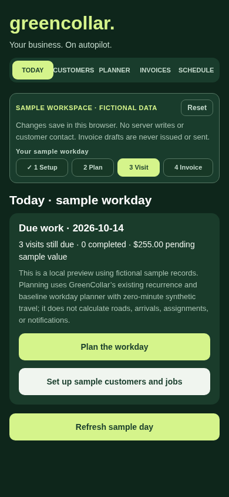
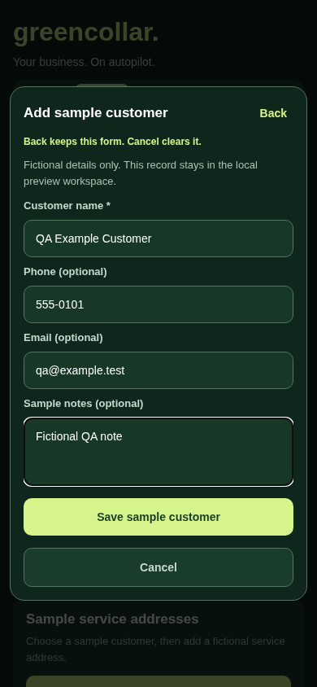
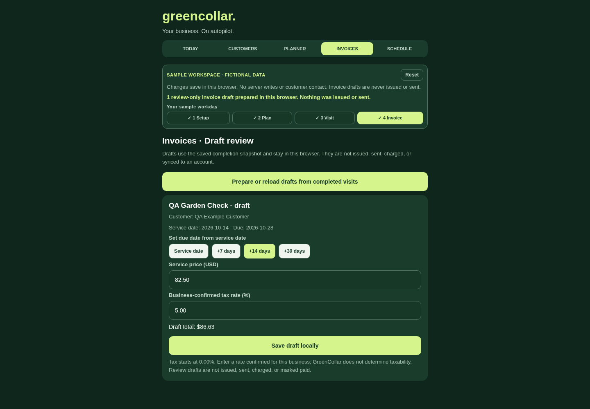
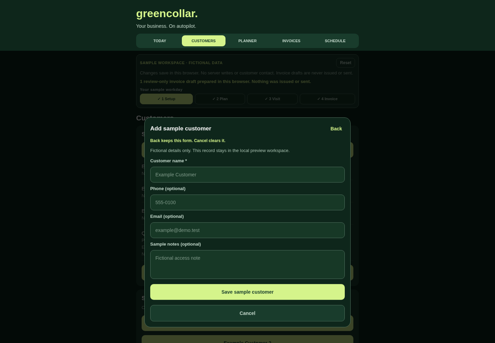

# GreenCollar real-app web preview

## Source and preview mode

This preview build renders the actual `GreenCollarDashboard` from `App.tsx`: Today, Customers, Planner, Invoices, and Schedule. `EXPO_PUBLIC_GREENCOLLAR_APP_PREVIEW=true` supplies a visibly named sample owner and workspace so all five real screens are available without an account or API call.

The in-app banner says Clerk and the Cloudflare API are disconnected. `EXPO_PUBLIC_GREENCOLLAR_API_URL` is intentionally unset. Values labeled Sample or Example are fixtures.

## What works in the preview

- Tab navigation across Today, Customers, Planner, Invoices, and Schedule.
- Browser-local creation of clearly labeled sample customers and service addresses.
- Browser-local recurring job creation using the app's current customer, service-location, and service-agreement field contracts. Daily, weekly, biweekly, monthly, and custom-day recurrences produce due visits on Today and Schedule.
- Customer, address, and schedule dialogs have Back, Cancel, validation messages, and guarded saves. Repeated save taps do not create duplicate entries.
- Planner workload calculations from fictional sample fixtures.
- Today supports building and saving a sample workday, starting/pausing/resuming a timer, saving visit notes, and completing planned visits with local billing snapshots. Invoice drafts can be prepared from those snapshots, edited, and saved locally.
- Workday, timer, visit, invoice, customer, address, and schedule changes persist in this browser's local storage. If storage is blocked, edits remain in page memory until reload. Clearing browser storage removes the saved preview edits. The reset confirmation restores the fictional workspace.

## Working UI verification

The branch's local Expo web export was checked in Chromium at 390 × 844 (phone-sized) and 1440 × 1000 (desktop). The checks covered customer/address/schedule forms and dialogs; workday planning and approval; cancel/back and validation paths; repeated saves; visit completion with a local billing snapshot; invoice-draft preparation, validation, save, and reload; reset cancel/confirm; and the session-only disclosure when browser storage is blocked. Both layouts fit without horizontal overflow and reported no application JavaScript errors. This verifies the local export; the upstream baseline artifact below is a different build. The standard-export favicon request may return 404 in the local static server; it does not affect the app.

The screenshots below were captured from the local export.

## Current local export and screenshots

- App source commit: `d43bc3a485a4c324c461a25a4214c7080c391bf4`
- Export: `EXPO_PUBLIC_GREENCOLLAR_APP_PREVIEW=true npm run export:web`, written to `dist/` with no Clerk key or API URL.
- Exact static export archive: `greencollar-web-d43bc3a.zip`; SHA-256 `d1058b61dcea172687509046e56210855685da4f1649678d475dda858df97911`.
- Web bundle: `_expo/static/js/web/AppEntry-e89018be85c1160bfaf926cfa8cee1c6.js`; SHA-256 `0499a521f71297d29e6600ee2deb63367fba827f034acd9be252ebb6f6ab5ffe`.
- Chromium smoke check passed at 390 × 844 and 1440 × 1000, with no horizontal overflow or application console errors. It exercised five-tab navigation; customer, address, and recurring-job validation; Back draft preservation and Cancel clearing; repeat saves; workday build and approval cancel/confirm; visit note, completion and billing snapshot; invoice validation, save and reload; and the session-only storage fallback.
- The screenshots use synthetic fixtures and show the local preview only.









## What requires Clerk and/or the Cloudflare API

- Sign in, account creation, and user session/token require `EXPO_PUBLIC_CLERK_PUBLISHABLE_KEY` and a configured Clerk instance.
- In a normal signed-in app session, business lookup/creation and saved customer reads/writes require Clerk session tokens plus `EXPO_PUBLIC_GREENCOLLAR_API_URL` pointing to a deployed Cloudflare Worker with the matching D1 database.
- In a normal signed-in app session, saved service locations and recurring service agreements require the authenticated Cloudflare API. Device GPS additionally requires browser/device location permission. The preview uses local sample records and does not request location access.
- In a normal signed-in app session, saved workday loading, queue status, completion/skip events, roster/availability, and schedule-draft saves require the authenticated Cloudflare API and matching migrations. In preview mode, the corresponding workday, timer, visit completion, and invoice-draft UI flows save only to this browser's demo workspace.
- In a normal signed-in app session, weather reports, invoice-draft load/save, routing readiness controls, and Google route-matrix requests require the authenticated Cloudflare API. Route-matrix requests also require provider configuration, enabled business settings, consent, and budget controls.

Preview edits are fictional browser data. They are not production records, do not create backend work orders, and do not notify or contact customers. No preview action writes to Clerk or Cloudflare. Server-backed workday, customer, schedule, invoice, and fieldwork writes, live routing, and location capture remain unavailable. The signed-in app retains its existing API guards and data contract.

## Upstream baseline Expo export

The values below describe the upstream export before this working UI update. The local export provenance and smoke-test status for this branch are recorded above.

- Source commit: `76912dfa09af6c00ab6ae2336fad6a710c9b1bce`
- Upstream source before the visual-preview route: `dd6293972388c13f8f79a86d23621c81f7b1f3a0`
- GitHub Actions run: https://github.com/newssmyrna/greencollar/actions/runs/38445403402
- Result: dependency install, Expo web export, and artifact upload succeeded.
- Artifact: `greencollar-expo-web` (artifact ID `11837809194`, expires 2026-10-20 18:17 UTC).
- Bundle output: `dist/`; no Clerk key or API URL was supplied.

Reproduce with:

```sh
npm install
EXPO_PUBLIC_GREENCOLLAR_APP_PREVIEW=true npm run export:web
```

The `GreenCollar Expo web export` workflow runs this on pull requests and retains the `dist/` artifact for seven days.

## Hosting

Publishing is managed separately by the owner. This public repository intentionally contains no private hosting URL, project identifier, deployment identifier, or access details. No host was created or changed as part of this source update.
